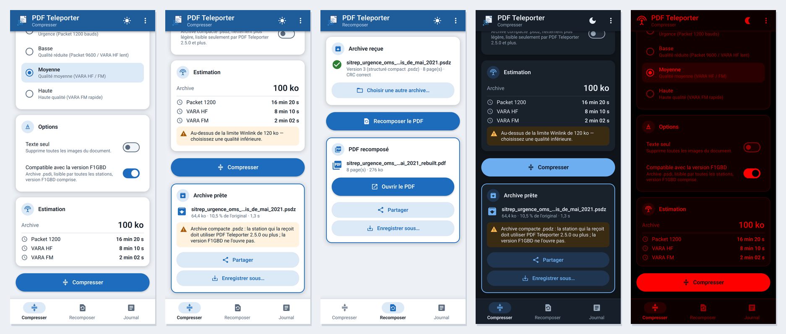

# PDF Teleporter pour Android

La version 2.6.0 de PDF Teleporter sur téléphone : le même moteur que la
version de bureau, réécrit en C++ sur MuPDF, sous une interface Qt Quick
pensée pour l'écran tactile. Les archives produites sont celles du bureau,
octet pour octet ; une archive `.psdi` reste lisible par toutes les stations,
version F1GBD comprise.

```
Compresser   PDF ou image → archive .psdi (ou .psdz compacte)
Recomposer   archive .psdi / .psdz → PDF
Journal      ce qui a été fait, pour le compte rendu d'exercice
```

## Pourquoi C++ et Qt, et pas Python

Une application Python pour Android passe par Kivy et Buildozer
(python-for-android) : il faut alors recompiler pour Android chaque module
natif — PyMuPDF, Pillow, et leurs propres dépendances — avec des recettes qui
suivent mal les versions, sous un NDK et un SDK que l'outil choisit lui-même.
C'est là que les compilations échouent.

Ici, rien de tout cela :

- **Qt 6.12** prend Android en charge officiellement, avec une liste de
  versions publiée et testée : JDK 21, SDK 36, build-tools 36.0.0,
  NDK r27c (27.2.12479018), Gradle 9.5.1 et le plugin Android 9.2.1 fournis
  par Qt lui-même. Ces versions sont figées dans `scripts/build-android.sh`.
- Le **moteur** est du C++17 compilé avec le reste par CMake, pour le bureau
  comme pour Android, depuis les sources de chaque bibliothèque à une version
  et un commit vérifiés (`scripts/fetch-third-party.sh`) : aucun paquet
  précompilé, aucune recette tierce.
- L'**interface** est en QML : une seule description, rendue de la même façon
  sur le téléphone et sur le bureau, où elle se teste.

## Fidélité au bureau

Le moteur reprend celui de la 2.6.0 fonction par fonction, et les
bibliothèques d'images sont celles qu'embarque Pillow 13.0.0, à la même
version : libjpeg-turbo 3.2.0, zlib-ng 2.3.3, libwebp 1.6.0, libavif 1.4.2
avec libaom 3.14.1. Le code de Pillow lui-même (rééchantillonnage,
quantification, conversions) est compilé tel quel.

Les tests différentiels (`tests/`) compressent et recomposent avec les deux
moteurs et comparent les résultats :

| Essai | Résultat |
|---|---|
| Compression `.psdi`, 14 PDF et 35 images (captures d'écran, scans, photos, tous formats et modes de couleur), plusieurs qualités | 161 archives identiques octet pour octet |
| Compression `.psdz` | identiques avec libaom 3.14.1 ; avec une autre libaom, seules les images AVIF diffèrent, et le format d'une page quand cette libaom fait l'AVIF plus léger (2 pages sur 84 avec la 3.8.2 d'Ubuntu 24.04) |
| Recomposition, 246 archives | 246 PDF identiques (hors identifiant aléatoire `/ID`) |
| Couche image, 3 466 opérations | toutes identiques, hors AVIF avec une autre libaom |

Les archives restent les mêmes, octet pour octet, quand le moteur est
compilé avec clang et libc++ 18 (la bibliothèque C++ du NDK) et le `char`
non signé des processeurs ARM, et quand il tourne dans une locale française
(virgule décimale).

Le C++ compresse 1,3 à 3 fois plus vite que Python, et recompose 2 à 20 fois
plus vite.

## L'interface



- **Trois destinations** dans la barre du bas : Compresser, Recomposer,
  Journal.
- **Compresser** : le document (PDF ou image JPEG, PNG, BMP, TIFF, WebP), la
  qualité, les options « Texte seul » et « Compatible avec la version F1GBD »
  — cochée à chaque démarrage, comme sur le bureau. L'estimation de la taille
  et des durées de transmission (Packet 1200, VARA HF, VARA FM) se met à jour
  d'elle-même ; la limite Winlink de 120 ko est signalée. Une compression
  déjà faite par l'estimation est reprise telle quelle.
- **Recomposer** : l'archive est vérifiée dès qu'elle est choisie (version,
  pages, CRC), puis recomposée.
- **Partager**, **Ouvrir le PDF**, **Enregistrer sous…** : la feuille de
  partage d'Android, l'application de lecture du téléphone, le sélecteur de
  fichiers du système.
- **Ouvrir avec / Partager vers PDF Teleporter** depuis une autre
  application (messagerie, gestionnaire de fichiers) : un PDF ou une image
  arrive sur Compresser, une archive sur Recomposer. Une archive `.psdi` sans
  type connu du système se reconnaît à son contenu.
- **Trois thèmes**, au bouton de la barre du haut ou dans le menu : clair,
  sombre, et **rouge** pour la nuit — tout y est rouge sur noir, y compris la
  fenêtre de démarrage, pour préserver la vision nocturne.
- **Plein écran**, Material Design : cartes en relief et ombres portées.
- L'application n'a besoin d'**aucune permission** : elle ne lit que les
  fichiers qu'on lui confie.

Sur le bureau, `pdfteleporter --tour DOSSIER document.pdf` parcourt toute
l'interface et enregistre une capture de chaque écran, dans les trois thèmes.

## Compiler l'APK sous Ubuntu 24.04

```
bash mobile/scripts/build-android.sh
```

Le script installe ce qu'il faut (paquets système, SDK et NDK Android dans
`~/pdft-android-tools`, Qt 6.12.0 par aqtinstall), récupère les sources
tierces, compile, aligne et signe. Il affiche les licences du SDK Android
et attend qu'on les accepte. Résultat :

```
mobile/dist/PDFTeleporter-2.6.0-android.apk
mobile/dist/PDFTeleporter-2.6.0-android.apk.sha256
```

Options :

```
--abis "arm64-v8a;armeabi-v7a"   les architectures (défaut : les téléphones,
                                 64 et 32 bits) ; "all" ajoute x86_64 et x86
--accept-licenses                accepte les licences du SDK sans les afficher
--no-apt                         n'installe aucun paquet système
--tools DIR / --build DIR        emplacements des outils et de la compilation
--clean                          repart d'un dossier de compilation vide (après
                                 un échec ou une mise à jour du projet)
```

**Signature.** Sans autre indication, l'APK est signée avec la clé de
débogage Android : elle s'installe sur un téléphone, mais une APK signée par
une autre clé ne pourra pas la mettre à jour. Pour diffuser, signer avec sa
propre clé :

```
PDFT_KEYSTORE=~/cles/pdfteleporter.jks PDFT_KEY_ALIAS=pdfteleporter \
PDFT_KEYSTORE_PASS=... PDFT_KEY_PASS=... bash mobile/scripts/build-android.sh
```

Il faut une dizaine de gigaoctets libres et, la première fois, une heure
environ.

**Messages sans conséquence.** La configuration affiche quantité de
« Performing Test … - Failed » : les bibliothèques tierces sondent le
compilateur, c'est attendu pour une compilation croisée. Deux avertissements
viennent de Qt lui-même : `Qt6QmlAssetDownloaderPrivate` introuvable faute
de `Qt6TaskTree` (un module QML de Qt que l'application n'utilise pas, absent
de l'installation de base), et la variable `QT_USE_ANDROID_TARGET_BUILD_DIR`
inutilisée (Qt la transmet à la compilation de chaque architecture).

**Installer** : copier l'APK sur le téléphone et l'ouvrir (autoriser
l'installation d'applications de source inconnue), ou
`adb install mobile/dist/PDFTeleporter-2.6.0-android.apk`. Android 9 ou plus
récent.

**Si l'application s'arrête**, le journal du téléphone dit pourquoi. Le
téléphone branché en USB, débogage USB activé :

```
bash mobile/scripts/android-log.sh            # --install : installe d'abord l'APK
```

Le script enregistre les plantages que le téléphone a gardés, lance
l'application, puis tout ce qui se journalise pendant qu'on reproduit le
problème, jusqu'à Ctrl+C. Le fichier est dans `mobile/dist/`.

**Deux FreeType dans l'APK.** Qt pour Android embarque son propre FreeType
dans `libQt6Gui` et en publie toutes les fonctions ; MuPDF a le sien, compilé
avec d'autres options. Lié dans l'ordre ordinaire, Qt d'abord, le programme
prenait chez Qt les fonctions que rien d'autre n'avait tirées de l'archive de
MuPDF, dont `FT_Add_Default_Modules` : les pilotes de polices de Qt
s'installaient dans le FreeType de MuPDF, et l'application s'arrêtait à la
première lettre mesurée, dès l'ouverture d'un PDF. FreeType est donc lié en
entier, les bibliothèques tierces restent internes au programme
(`--exclude-libs`), et après chaque édition de liens
`cmake/CheckOwnSymbols.cmake` arrête la compilation si une fonction des
archives de MuPDF vient encore d'une autre bibliothèque. Sur le bureau, le
programme ne publie plus non plus les FreeType, libjpeg, zlib, Brotli et xz
qu'il embarque, que Qt, fontconfig et HarfBuzz utilisaient à la place de ceux
du système.

## Compiler sur GitHub

Le workflow `.github/workflows/mobile.yml` fait tout sur les serveurs de
GitHub, à chaque modification de `mobile/` :

- **tests** : compilation sur le bureau, tests différentiels contre le moteur
  Python, visite de l'interface sur Qt 6.4 et contrôle du QML sur Qt 6.12, le
  Qt de l'APK ; les captures sont dans l'artefact `tests-and-screens` ;
- **APK** : arm64-v8a, armeabi-v7a et x86_64, dans l'artefact
  `PDFTeleporter-android` ; un tag `v*` la joint à la release.

Pour signer avec sa clé, déclarer dans les secrets du dépôt
`ANDROID_KEYSTORE_BASE64` (`base64 -w0 cle.jks`), `ANDROID_KEY_ALIAS`,
`ANDROID_KEYSTORE_PASSWORD` et `ANDROID_KEY_PASSWORD`. Lancer le workflow
vaut acceptation des licences du SDK Android.

## Compiler et tester sur le bureau

```
bash mobile/scripts/build-desktop.sh --test
```

Construit, sur le Qt 6.4 d'Ubuntu, `pdft-cli` (le moteur seul) et
`pdfteleporter` (l'interface), puis lance les tests différentiels et la
visite de l'interface. `--local-avif` compile libaom et libyuv depuis leurs
sources, comme pour Android, au lieu de prendre celles du système.

Les tests différentiels portent sur les deux PDF du dépôt et sur quatre
images construites par `tests/make_images.py` — une capture d'écran, une page
en noir et blanc, un scan en gris et une photo —, chacune à cinq réglages.

Les fenêtres de choix de fichier sont celles de GNOME grâce au paquet
`qt6-gtk-platformtheme`. Là où Qt n'en a pas à montrer, il dessine les
siennes, qui demandent `qml6-module-qt-labs-folderlistmodel` : sans ce
module, le Qt 6.4 d'Ubuntu s'arrête net à l'ouverture. Le script installe
les deux ; avec `--no-apt`, les installer soi-même.

```
pdft-cli compress document.pdf archive.psdi --quality low
pdft-cli rebuild archive.psdi document.pdf
```

Contrôle du QML sur le Qt de l'APK, sans rien compiler :

```
pip install -r mobile/tests/requirements.txt
QT_QPA_PLATFORM=offscreen python3 mobile/tests/ui_preview.py captures/
```

## Versions figées

| Composant | Version |
|---|---|
| Qt (Android et outils hôtes) | 6.12.0, par aqtinstall 3.3.0 |
| Android | minimum API 28 (Android 9), cible API 36 |
| SDK | platform android-36, build-tools 36.0.0, cmdline-tools 13114758 |
| NDK | 27.2.12479018 (r27c) |
| JDK | 21 |
| Gradle, plugin Android | 9.5.1, 9.2.1 (modèles de Qt 6.12) |
| MuPDF | 1.28.6 |
| libjpeg-turbo, zlib-ng | 3.2.0, 2.3.3 |
| libwebp, libavif | 1.6.0, 1.4.2 |
| libaom, libyuv | 3.14.1, 644251f2 |
| XZ Utils (liblzma) | 5.8.4 |
| Pillow (libImaging) | 13.0.0 |

## Arborescence

```
app/                 le C++ de l'interface : Backend (ce que voit le QML),
                     journal, partage et fichiers reçus, visite (--tour)
qml/                 l'interface : pages, cartes, thèmes, icônes Material
android/             manifeste, activité Java, icônes, thème de démarrage
src/core/            format .psdi/.psdz, JSON, LZMA, façade MuPDF
src/engine/          compression et recomposition
src/imaging/         images comme Pillow : libImaging de Pillow 13, codecs
cmake/               MuPDF, codecs et libjpeg-turbo construits depuis leurs sources ;
                     contrôle des symboles après chaque édition de liens
scripts/             récupération des sources, compilation Android et bureau
tests/               tests différentiels, aperçu de l'interface sur Qt 6.12
tools/               pdft-cli ; génération des icônes et des mentions tierces
legal/               mentions des composants tiers (affichées dans À propos)
```

## Licence

GNU GPL v3 (`GPL-3.0-only`), comme le reste du projet. L'application
incorpore MuPDF, sous GNU AGPL v3, Qt sous GNU LGPL v3, et des composants sous
licences permissives : leur liste et leurs textes sont dans
`legal/THIRD_PARTY_NOTICES.txt`, que la fenêtre À propos affiche, avec le
texte de la GPL. `tools/make_notices.py` régénère ce fichier quand une version
change.
